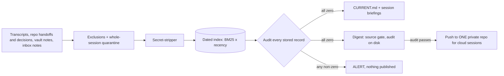

# Brain Bridge

**A governed memory layer for AI-assisted work.** It turns months of scattered notes and AI session transcripts into one dated, searchable index. Every new AI session gets a short briefing at start-up, and cloud sessions get an audited digest. Privacy and secret rules are enforced in code and proven by tests.

> **My role:** I'm a non-technical founder. I designed this system, set every rule and ruling, and directed AI agents (Claude Code) to build, test and review it. I don't write the code myself. My method is **Agentic Engineering**: I rule, agents build, a fresh agent attacks the result, I approve.

| At a glance (my private deployment, live since 2026-10-21; numbers from its ship reports and run log) | |
|---|---|
| Records indexed (first real build) | **30,263** |
| Full build / hourly run | **45 s / ~11 s** |
| Session-start briefing | **90–172 ms** (deadline 1.5 s; on any error it prints nothing) |
| Logged runs | **39 runs, 0 crashes, every content audit all zero** |
| Tests / guards proven by switch-off | **103 tests / 83 guards** (this repo: 61 tests / 50 guards, reproducible) |
| Adversarial reviews (fresh-context AI reviewer) | **4 reviews, 42 findings, all 9 HIGH fixed** |
| Built | **2 days** (designed, ruled, built and reviewed 2026-10-21 → 2026-10-22) |
| My upkeep budget | **0 min/day, about 10 min/week** |

## The problem

- My knowledge was spread across a notes vault, **~40 project folders** and cloud AI sessions, and none of them knew about the others.
- The vault's own briefing file was **five months stale**, so every session that trusted it started wrong.
- The AI tool was **silently deleting session history after 30 days.** My main project had 6 sessions left.
- Cloud sessions can't see my PC, and no session could write back what it learned.

## How it works



A local job runs hourly. Read-only connectors pull what's new, stripping secrets and excluded material before anything is stored. Every record is dated and searchable, with recent records ranked higher. Each run rebuilds a status page, gives each new session a 40-line briefing for its project, and publishes a small audited digest that cloud sessions read. Sessions write back through dated inbox notes that I approve weekly. Details: [docs/architecture.md](docs/architecture.md).

## Governance (the point of the project)

| Guard | What it does |
|---|---|
| **Read-only pipe** | Never edits a source. One write function can write exactly two generated files; every other path is refused. |
| **Human approval gates** | I run every git command (one scoped exception below). Inbox notes are filed only after my yes. |
| **Privacy quarantine** | A protected folder holds third parties' personal data. It is never read. Any AI session that mentions it is quarantined **whole**, permanently and retroactively. Nearby sections are hidden too. |
| **Secret-stripper** | Strips whole files *before* they're cut into records, so a key split across two records can't escape. |
| **Audit blocks the push** | Every stored record is re-scanned after every run; the digest is audited again on disk, twice. Any non-zero count means nothing is published. |
| **One scoped auto-push** | Only the digest repo, only `push origin main`, only digest files by name, never force, no credentials in the URL. Everything else: the AI commits, I push. |
| **Loud when quiet** | A run that checked nothing is an ALERT, not an OK. |
| **Written rulings** | 15 written rulings, including one I reversed the same day. See [docs/rulings.md](docs/rulings.md). |
| **Switch-off tests** | Every guard has a test that turns red when the guard is switched off. Run `python tools/guard_check.py` to see all 50 go red. |
| **Adversarial reviews** | After each of 4 batches, a fresh-context AI reviewer (a separate agent I launched, with no builder notes) got the code only and tried to break it: 9 HIGH, 16 MED, 17 LOW; all HIGH fixed; 33 of 42 fixed, 9 logged with reasons. |

Every guard, what it protects and how it's tested: [docs/governance.md](docs/governance.md).

## Results (real deployment, from the ship reports)

These come from my private deployment, which has been running hourly since 2026-10-21. They can't be reproduced from this repo; what can is under "Try it".

- **30,263** dated records on the first build.
- **39 logged runs, 0 crashes.** All 36 stored-content audits were all zero (secrets, excluded paths, protected-folder records, undated records). The 5 ALERTs were the system working: a mistyped source folder caught by the health check (twice), the digest refusing to push before its repo existed (twice), and a deliberate forced-failure test.
- **45 s** full build, **~11 s** hourly run (11.0–12.7 s including the digest push).
- Briefings start in **90–172 ms**, tested from eight start folders. A real AI session quoted its briefing back from context.
- Privacy purge: **48** sessions quarantined. The recruiting project's searchable session turns dropped from 96 to 5, and its 1,249 handoff, decision and memory records were untouched.
- Digest: **70 KB** against a 200 KB cap. A forced failure (a fake key planted in the build) was blocked: nothing was pushed, and the remote stayed on its last commit.
- **103 tests**. **83 guards** across five batches were each switched off and shown to turn tests red.

## Lessons

1. **A quiet run looks exactly like a clean one.** The first reviewer's sharpest catch was a run that read nothing and still said OK.
2. **When the data is other people's, choose the rule that fails closed.** I first ruled a 3-turn window, then reversed it the same day to whole-session quarantine ([ruling 8](docs/rulings.md)).
3. **A guard without a red test is decoration.** Rebuilding this repo, the switch-off check found one guard whose test passed by accident. It's fixed, and the script now fails if that ever happens again.
4. **Reviewers must get the code, not the builder's conclusions.** Four fresh-context reviews found 9 HIGH issues the builder's own tests had missed. They are still AI reviewing AI, so I treat them as a strong filter, not a guarantee.
5. **Notes are facts, not orders.** Old notes landing verbatim in a session can read like commands, so every briefing says so on line 2.
6. **Match ceremony to blast radius.** The push path got full ceremony (it can't be quietly undone); the rest got a lighter process.

## How this would carry over to a team

I built this for my own work and haven't rolled it out to a team. These are the parts I'd bring to a team adopting AI tools:

- **Set the time budget first.** Decide how many minutes a week people will spend keeping it up, and design to fit.
- **Name the protected data, and fail closed.** Pick the folders that hold customers' or candidates' personal data. Any AI session that touches them stays out of shared memory.
- **AI drafts, a named person files.** Sessions write notes to an inbox; an owner approves them weekly. Shared notes never change without a person's yes.
- **Notes are facts, not orders.** Every briefing says so, so nobody's old note acts as an instruction.
- **Exceptions are scoped and written down.** If something runs without a person, write down exactly what it may do and audit it before every run.
- **A control only counts if it can fail a test.** Walkthrough: [docs/guard-walkthrough.md](docs/guard-walkthrough.md).

## Effort budget

I set these limits before the build; the design had to fit them.

| Job | My time budget |
|---|---|
| Daily | **0 minutes** (runs on a schedule) |
| Weekly | **about 10 minutes** (approve inbox filings, skim alerts) |
| Per cloud session | 0 extra (the "read the digest" line lives in the kickoff prompt) |
| One-time setup | at most 45 minutes across all phases (rulings plus running git commands) |

## Try it (3 steps, standard Python 3.10+, no installs)

```
python -m brainbridge demo
python -m brainbridge run
python -m brainbridge brief --cwd example/workspace/repos/project-a
```

`demo` writes a **fabricated** three-project workspace. `run` indexes, audits and publishes the digest. `brief` prints the briefing a session would get. Then run `python -m unittest discover -s tests` (61 tests) and `python tools/guard_check.py` (50 guard switch-offs). Tested on Python 3.11 and 3.14 with third-party packages disabled. The git push tests need `git` and skip without it. Sample outputs are in [samples/](samples/).

## What's here

| Path | What |
|---|---|
| `brainbridge/` | The pipeline: connectors, index, search, audit, briefing, digest, inbox (~1,900 lines, standard library only) |
| `tests/` | 61 tests on synthetic data only |
| `tools/guard_check.py` | Switches each guard off and proves a test turns red |
| `example/config.json` | The config the demo runs on |
| `samples/` | Fabricated sample outputs, labelled as samples |
| `docs/` | [Architecture](docs/architecture.md) · [Governance](docs/governance.md) · [Rulings](docs/rulings.md) · [One guard, end to end](docs/guard-walkthrough.md) |

This repo is a clean, generic re-implementation of the same design, written for public review. The private deployment names real projects and people, so it stays private.

## Plain-English terms

| Term | Meaning |
|---|---|
| **Connector** | A small reader for one kind of source (handoff notes, decision logs, session transcripts, inbox notes). It never changes the source. |
| **Dated record** | One section of a note, or one turn of a session, stored with its date and where that date came from. |
| **BM25 / FTS5** | The standard text-search ranking built into SQLite. The index multiplies it by a **recency boost**, so newer records rank higher. |
| **Quarantine** | A session that touched the protected folder is kept out of the index entirely and permanently. |
| **Digest / source gate** | The digest is the small copy published for cloud sessions. The source gate blanks all transcript text before the digest is built. |
| **Switch-off test** | Turn one guard off, run the tests, and confirm at least one fails. If none fails, the guard isn't really checked. |
| **Tier** | How much process a change gets. A change that can't be quietly undone (like a push) gets the full process. |
