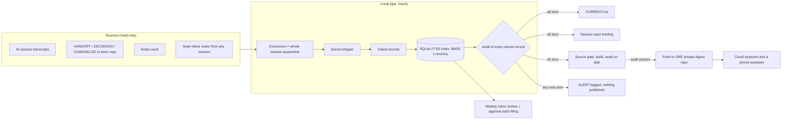

# Architecture

## The problem it solves

My knowledge was in six places, and none of them knew about the others:

- a notes vault whose briefing file was five months stale;
- about 40 project folders, each with its own handoff, decisions and AI memory notes;
- full AI session transcripts, which the tool **silently deleted after 30 days**;
- cloud AI sessions, which can't see my PC at all;
- and no way for a session to write back what it learned.

## The shape: one pipe in, one search, one way out

## The layers

| Layer | What it does | In this repo |
|---|---|---|
| **1. Connectors** | One read-only reader per source, each remembering where it stopped (size + mtime + sha1 for notes, a byte offset for transcripts). Each file belongs to exactly one connector. | `brainbridge/connectors.py` |
| **2. Summaries** | Deferred by ruling (a later phase). | — |
| **3. Search with recency** | SQLite FTS5 (BM25) multiplied by a recency boost, `1 + 0.5^(age/60 days)`, applied inside SQL so the candidate cut-off can't drop a recent record. Every record carries a date and the source of that date. | `brainbridge/search.py`, `chunk.py`, `store.py` |
| **4. Auto-briefing** | `CURRENT.md` is rebuilt every run: active projects with their last real status, 14 days of decisions, and index health. A session-start hook prints a short briefing for whichever project a session opens in. | `brainbridge/current.py`, `briefing.py` |
| **5. Cloud bridge** | A small digest built from a gated copy of the index (transcript text blanked), audited on disk, and pushed to one private repo. | `brainbridge/digest.py` |
| **6. Write-back** | Sessions drop dated notes in `brain-inbox/`. They are indexed, shown as "(inbox, not yet filed)", and listed in a weekly review. I approve each filing. | `brainbridge/inbox.py`, `vault_write.py` |
| **7. Stay fresh** | Health checks make a quiet run an ALERT; one log line per run. | `brainbridge/pipeline.py` |

## A run, step by step

1. Take a lock (a second run can't overlap).
2. If the transcript rule changed since the last run, re-read every session from the start.
3. Walk the vault and source folders. Excluded folders are pruned before they are entered.
4. Index the notes (handoff, decisions, vault, inbox), stripping secrets from the whole file first.
5. Index new transcript turns. Any session naming the protected folder is quarantined whole, and anything stored earlier from it is deleted.
6. Prune notes that left disk. Keep transcripts: the source deletes them, and keeping them is half the point.
7. Audit every stored record, then run the health checks.
8. Write `CURRENT.md` and the inbox review (through the only allowed write path), and log one line.
9. Build the digest from a gated copy, audit the staged files, sync, audit again, then commit and push (or just publish to a folder).

## The real deployment vs. this repo

| | Real deployment | This repo |
|---|---|---|
| Scheduler | Windows Task Scheduler, hourly | You run `python -m brainbridge run` |
| Sources | ~40 project folders, a vault, months of transcripts | A fabricated three-project workspace |
| Digest | Pushed hourly to a private GitHub repo | A local folder; set `digest_remote` to test the push path (the tests push to a local bare repo) |
| Extra features | Project aliases, folder-to-project mapping, stale-briefing warnings from git history, a second reader skill | Left out to keep the code small and readable |
| Guards | 83 switch-offs proven across five batches | 50 switch-offs, reproducible with `tools/guard_check.py` |

This repo is a clean, generic re-implementation of the same design for public review. It isn't a copy of the private code, which names real projects and paths.
